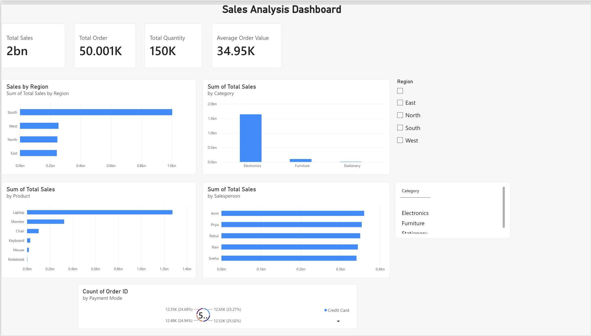

# Sales Analysis Dashboard – Power BI

## Project Overview

This project focuses on analyzing sales data and creating an interactive sales dashboard using Microsoft Power BI.

The objective was to transform sales data into meaningful KPIs and visualizations that help understand overall sales performance.

## Tools Used

- Microsoft Power BI
- DAX
- Power BI Visualizations

## Dataset

The dataset contains approximately 50,000 sales records with information such as:

- Order ID
- Order Date
- Customer Name
- City
- State
- Product
- Category
- Salesperson
- Quantity
- Price
- Discount
- Total Sales
- Payment Mode
- Region

## Dashboard KPIs

The dashboard includes:

- Total Sales
- Total Orders
- Total Quantity
- Average Order Value (AOV)

## Visualizations

The dashboard includes:

- Sales by Region
- Sales by Category
- Sales by Product
- Sales by Salesperson
- Payment Mode Distribution

## Interactive Features

Two slicers were added to make the dashboard interactive:

- Region
- Category

Selecting a region or category dynamically filters the KPIs and visualizations on the dashboard.

## DAX

A measure was created to calculate Average Order Value (AOV):

```DAX

Average Order Value =
DIVIDE(
    SUM('Sales_Analysis_Project_50000_Rows'[Total Sales]),
    DISTINCTCOUNT('Sales_Analysis_Project_50000_Rows'[Order ID])
)

```

## Dashboard Preview


